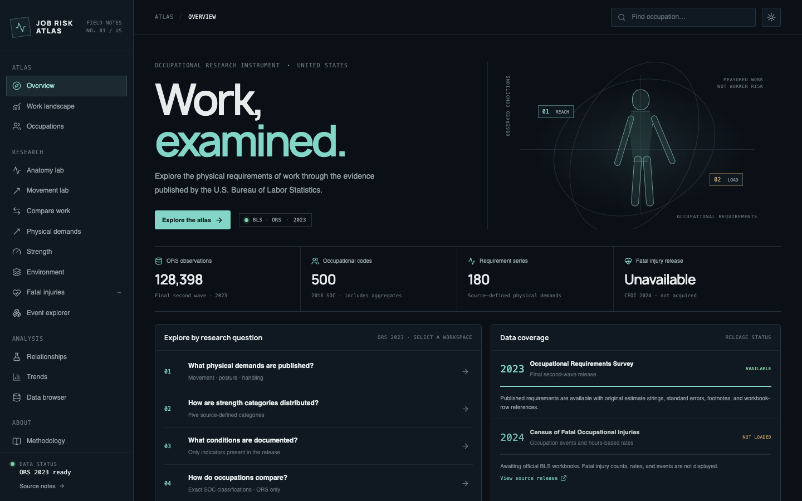
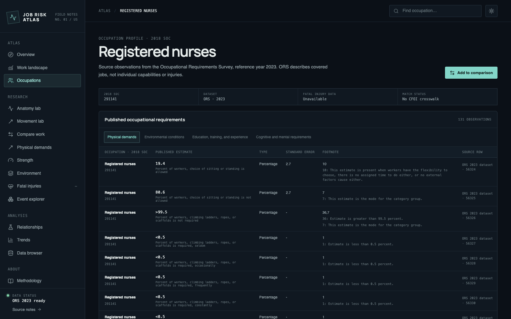
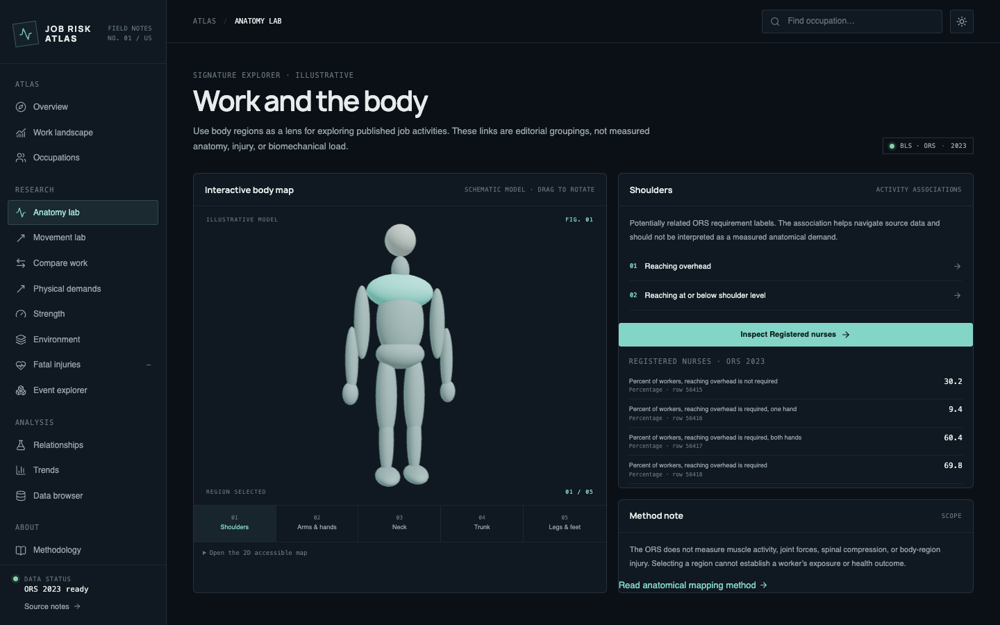
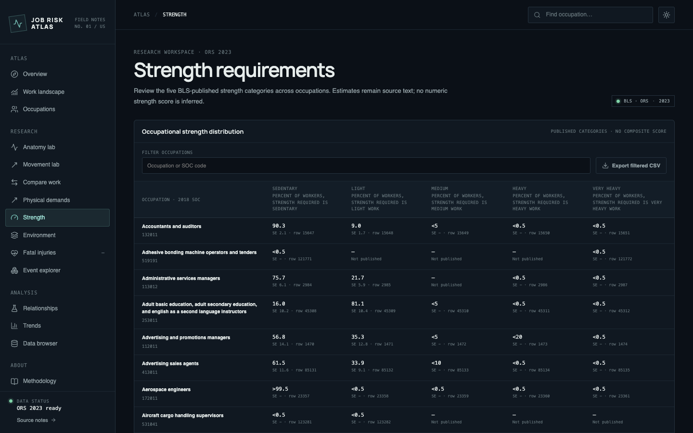
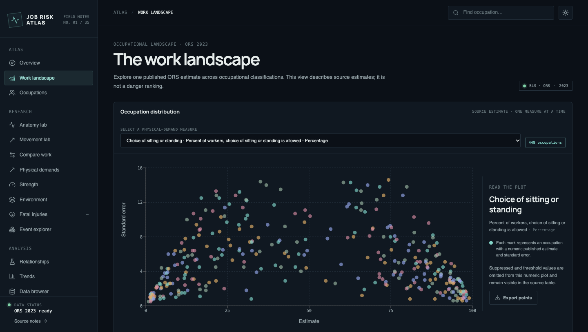
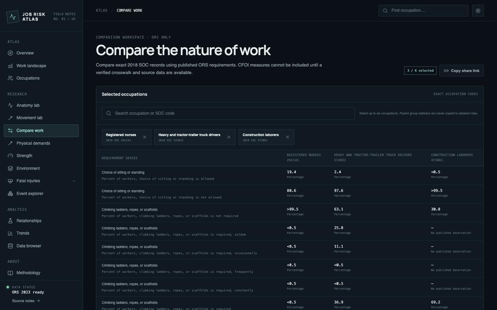
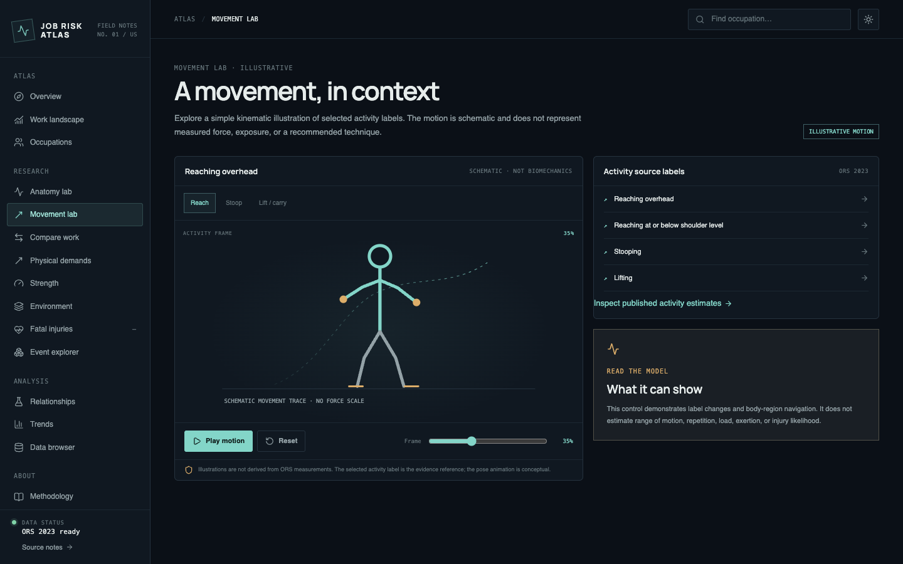
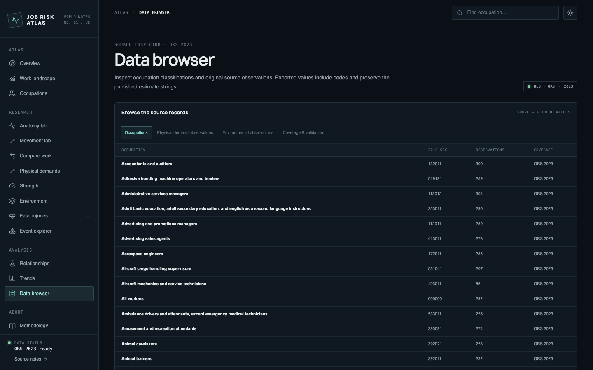
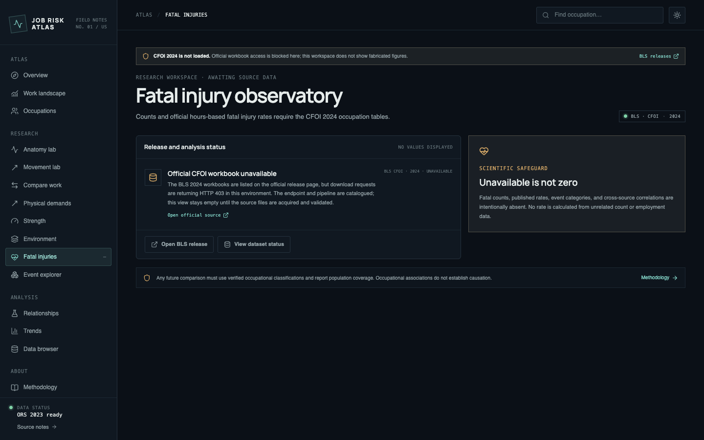
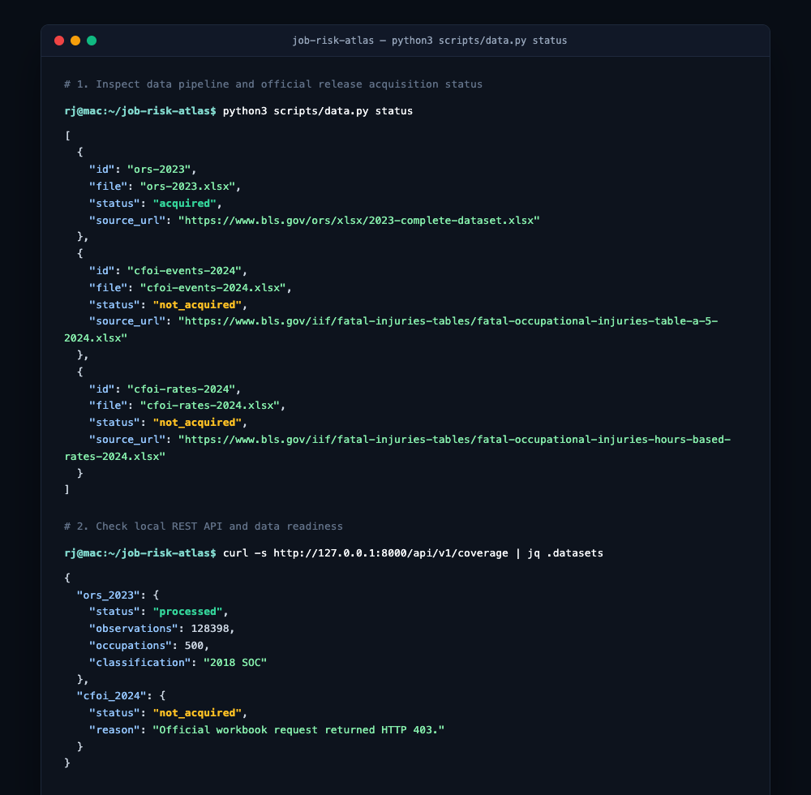

# Job Risk Atlas

Job Risk Atlas is an evidence-led research interface and data pipeline for examining published occupational requirements and observed fatal work injuries in the United States. Grounded strictly in official U.S. Bureau of Labor Statistics (BLS) data, it preserves raw estimate labels, standard errors, footnotes, and workbook row provenance, avoiding synthetic danger rankings, unverified linkages, or treating occupational statistics as individual risk predictions.



---

## What Problem It Solves

Occupational datasets are often flattened into composite "danger scores" or misapplied as individual worker risk forecasts. In reality:

- **Requirements describe jobs, not people**: The BLS Occupational Requirements Survey (ORS) measures job demands among covered establishments—it does not assess individual capability, biomechanical strain, or injury causation.
- **Fatal injury records describe observed events**: The Census of Fatal Occupational Injuries (CFOI) counts work fatalities; it operates on different reference years, survey scopes, and populations from ORS.
- **Unavailable is not zero**: Suppressed estimates, threshold values (`<0.5%`, `>99.5%`), and missing series are frequently coerced to zero in downstream tools, distorting scientific reality.

Job Risk Atlas treats occupational data with econometric rigor: preserving original string estimates, providing row-level audit trails back to the published source workbooks, and keeping data availability transparent.

---

## Core Workspaces & Capabilities

- **Occupations Directory & Profiles**: Search and inspect 500 official 2018 SOC classifications, complete with physical demand percentages, environmental exposures, cognitive requirements, standard errors, and survey footnotes.
- **Interactive 3D Anatomy Lab**: An interactive 3D human body model (Three.js / React Three Fiber) connecting anatomical regions (Shoulders, Arms & hands, Neck, Trunk, Legs & feet) to published ORS activities.
- **Occupational Strength Matrix**: Compare occupations across the five BLS-defined strength categories (_Sedentary_, _Light work_, _Medium work_, _Heavy work_, _Very heavy work_) with raw strings and filtered CSV export.
- **The Work Landscape**: Interactive scatter plot (Recharts) plotting numeric estimates against standard errors across occupations to inspect distribution patterns.
- **Schematic Movement Lab**: Biomechanical movement demonstrations (Reach, Stoop, Lift/carry) with kinematic traces linked directly to ORS activity definitions.
- **Multi-Occupation Comparison**: Align and compare up to six exact SOC codes side-by-side across identical ORS series with shareable URL parameters.
- **Data Browser & Provenance Inspector**: Raw table viewer with workbook sheet, row, and footnote audit trails, plus verified SHA-256 acquisition manifests.
- **Honest Dataset Availability**: CFOI 2024 is catalogued with official URLs and checksum manifests; because restricted environments block direct XLSX downloads, the system presents clear, non-synthetic unavailable states.

---

## Visual Tour

### Occupation Profile & Requirements

Detailed view of exact published requirements for registered nurses (2018 SOC 291141), preserving standard errors, footnote definitions, and source workbook row references.



### 3D Anatomy Lab

Interactive 3D anatomical viewer built with React Three Fiber, organizing published activity categories by illustrative body regions.



### Occupational Strength Distribution

Comparison across the five source-defined BLS strength tiers without computing artificial composite scores.



### The Work Landscape

Distribution scatter plot showing estimate percentages against their published standard errors.



### Multi-Occupation Comparison

Side-by-side requirement comparison across exact SOC classifications with direct link-sharing support.



### Movement Lab

Kinematic trace visualization contextualizing ORS physical demand labels.



### Data Provenance & Source Browser

Auditing raw observations, workbook coordinates, and dataset validation records.



### Transparent Release Status

Honest reporting when upstream government datasets are unacquired, preventing fabricated figures.



---

## CLI & Data Pipeline

The acquisition, XLSX inspection, streaming parser, and SQLite materializer are built with Python standard library modules (`zipfile`, `xml.etree.ElementTree`, `sqlite3`, `urllib`).



```bash
# Check dataset acquisition and pipeline readiness
python3 scripts/data.py status

# Acquire official ORS 2023 release workbook
python3 scripts/data.py acquire ors-2023

# Inspect workbook metadata, sheet structure, and cell previews
python3 scripts/data.py inspect ors-2023

# Materialize raw workbook into analytical SQLite database
python3 scripts/data.py build ors-2023
```

---

## Requirements

- **Node.js**: 20.x or 22.x (Node 22 LTS recommended)
- **pnpm**: 10.x (or npm)
- **Python**: 3.10 or later (standard library only; no external Python packages required)
- **Official Data**: Pre-materialized in `data/processed/ors-2023.sqlite3` (128,398 observations, 500 occupations)

---

## Getting Started

### 1. Install Dependencies

```bash
pnpm install
```

### 2. Start Development Mode

Starts both the local read-only Python API and the Vite React frontend concurrently:

```bash
pnpm dev
```

- Web Dashboard: `http://127.0.0.1:3000`
- REST API: `http://127.0.0.1:8000` (Vite proxies `/api` to the backend)

To run them individually in separate terminal sessions:

```bash
pnpm api       # Starts Python backend on port 8000
pnpm dev:web   # Starts Vite development server on port 3000
```

### 3. Production Build & Serve

```bash
# 1. Type-check and compile frontend bundle
pnpm build

# 2. Serve production assets and API through local server
python3 server.py
```

Set `PORT` to change the default port (e.g., `PORT=8080 python3 server.py`). When `dist/` is present, `server.py` serves both the static application bundle and the `/api/v1/` endpoints.

---

## Local REST API

The backend exposes a read-only, parameterized SQL API backed by SQLite:

| Endpoint                                 | Method        | Description                                                       |
| ---------------------------------------- | ------------- | ----------------------------------------------------------------- |
| `/api/v1/health`                         | `GET`, `HEAD` | System health and dataset readiness                               |
| `/api/v1/coverage`                       | `GET`         | Observation totals, occupation count, and requirement domains     |
| `/api/v1/metadata`                       | `GET`         | Dataset provenance, reference years, and SHA-256 hashes           |
| `/api/v1/validation`                     | `GET`         | Automated materialization validation report                       |
| `/api/v1/occupations`                    | `GET`         | Search occupations by title or SOC code (`q`, `limit`, `offset`)  |
| `/api/v1/occupations/{soc}`              | `GET`         | Occupation detail by 6-digit or hyphenated SOC code               |
| `/api/v1/occupations/{soc}/requirements` | `GET`         | Exact ORS requirement rows with standard errors and footnotes     |
| `/api/v1/series`                         | `GET`         | Catalog of source-defined ORS requirement series                  |
| `/api/v1/series/{code}`                  | `GET`         | All occupational observations for an estimate series              |
| `/api/v1/strength`                       | `GET`         | Five-category strength matrix across occupations                  |
| `/api/v1/events`                         | `GET`         | Returns 503 `dataset_unavailable` until CFOI workbooks are loaded |

### Example Query

```bash
curl -s "http://127.0.0.1:8000/api/v1/occupations?q=47-2061" | jq .
```

```json
{
  "items": [
    {
      "soc_code": "472061",
      "occupation": "Construction laborers",
      "observation_count": 277
    }
  ],
  "total": 1,
  "limit": 20,
  "offset": 0,
  "datasets": {
    "ors_2023": "available",
    "cfoi_2024": "unavailable"
  }
}
```

---

## Verification & Testing

The repository includes an automated regression and scientific test suite covering the data pipeline, database integrity, and REST API:

```bash
# Run full test suite
python3 -m unittest discover -s tests -v

# Or via pnpm
pnpm test

# Run frontend type checking & build verification
pnpm build

# Run Python compilation check
python3 -m py_compile server.py scripts/data.py
```

All 19 tests pass:

- **Pipeline Integrity**: Verified 128,398 observations, 500 unique occupations, zero null SOC codes, and preservation of text markers (`<0.5`, `>99.5`, `-`).
- **API & Endpoints**: Validates search with and without hyphens, series zero-padding, strength matrices, HEAD requests, and 503 unavailable responses for absent datasets.

---

## Scientific Safeguards

1. **Source Preservation**: Raw estimate strings (including threshold markers like `<0.5` and `>99.5`), standard errors, footnotes, and workbook row provenance are preserved verbatim.
2. **No False Equivalence**: Parent occupation averages are never copied down to detailed occupations.
3. **Unavailable Is Not Zero**: Missing or suppressed observations are displayed as unavailable, never as zero.
4. **Different Populations & Years**: ORS 2023 describes requirement prevalence among covered civilian jobs; CFOI 2024 counts fatal work injuries. They are not worker-level linked records.
5. **No Artificial Danger Scores**: The application refuses to rank occupations by an arbitrary single composite score.
6. **Illustrative Anatomy**: Anatomical groupings serve navigation purposes only and do not constitute clinical biomechanics, ergonomic assessments, or injury probabilities.

---

## Project Architecture

```text
job-risk-atlas/
├── data/
│   ├── manifests/         # SHA-256 acquisition manifests & download records
│   ├── processed/         # ors-2023.sqlite3 (128K rows) & validation report
│   └── raw/               # Official source workbooks (ors-2023.xlsx)
├── docs/
│   ├── screenshots/       # Application and CLI visual showcases
│   ├── architecture.md    # System design and component data flow
│   ├── data-sources.md    # BLS source documentation and URLs
│   ├── limitations.md     # Scientific scope, safeguards, and boundaries
│   └── testing.md         # Verification status and test documentation
├── scripts/
│   └── data.py            # Acquisition, inspect, and materializer CLI
├── tests/
│   ├── test_api.py        # Automated REST API & endpoint tests
│   └── test_pipeline.py   # Database & scientific integrity tests
├── web/
│   ├── src/
│   │   ├── App.tsx        # React application shell and workspace views
│   │   ├── BodyScene.tsx  # Three.js / React Three Fiber 3D anatomical model
│   │   ├── Charts.tsx     # Recharts scatter plot & bar chart components
│   │   └── styles.css     # Dark/light theme design system
│   └── index.html         # Application HTML entry point
├── server.py              # Zero-dependency local REST API & static server
├── vite.config.ts         # Vite bundler configuration & API proxy
└── package.json           # Node scripts and dependencies
```

---

## Documentation

- [Architecture & Design](docs/architecture.md)
- [Official Data Sources](docs/data-sources.md)
- [Data Dictionary](docs/data-dictionary.md)
- [Data Pipeline & Materialization](docs/data-pipeline.md)
- [Scientific Methodology](docs/scientific-methodology.md)
- [Scientific Limitations & Safeguards](docs/limitations.md)
- [Occupational Matching Principles](docs/occupational-matching.md)
- [Anatomical Mapping Rationale](docs/anatomical-mapping.md)
- [REST API Specification](docs/api.md)
- [Testing & Verification](docs/testing.md)

---

## Attribution

Official BLS publications are works of the U.S. Government and in the public domain. Please review the [BLS Copyright Policy](https://www.bls.gov/opub/copyright-information.htm) for more information.

## License & Custom Work

[](mailto:work@withrana.com) [](https://www.linkedin.com/in/workwithrana)
[](https://www.upwork.com/freelancers/~01bbcf6edb91a8df5f)
[](https://contra.com/ranajahanzaib/)

**License:** MIT, see [LICENSE](LICENSE). Free for personal, academic, and commercial use.

**Author:** Rana Jahanzaib

**Need this built for your stack?** Email me what you're working on: work@withrana.com
